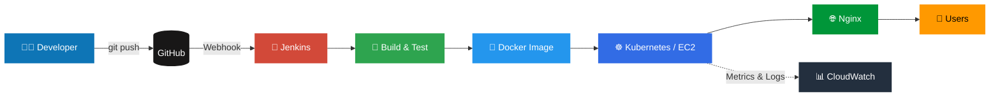

<!-- ═══════════════ HEADER (animated wave) ═══════════════ -->
<div align="center">


<!-- Typing animation -->
<a href="https://github.com/roshanonline">
  
</a>

<br/>


<br/><br/>

<!-- Quick navigation -->
<a href="#-about-me"></a>
<a href="#-tech-stack"></a>
<a href="#-cloud--devops-architecture"></a>
<a href="#-github-analytics"></a>
<a href="#-lets-connect"></a>

</div>

---

## 🚀 About Me

<div align="center">

</div>

<br/>

```yaml
name: Kirthick Roshan
role: Cloud & DevOps Engineer
education: B.E. Computer Science Engineering (Final Year)
focus:
  - Cloud Computing (AWS)
  - DevOps & CI/CD Automation
  - Containerization & Orchestration
  - AI/ML in Cloud-Native Systems
currently_learning: [Kubernetes, Terraform, AI/ML Deployment]
philosophy: "Automate everything. Ship reliably. Keep learning."
```

- ☁️ Building and deploying applications using **AWS** and modern DevOps tools.
- 🐳 Interested in **containerization, CI/CD pipelines, Linux administration** and cloud infrastructure.
- 🤖 Exploring **AI/ML integration** into real-world applications and cloud-native systems.

### 🔧 Currently Working With

<div align="center">

| ☁️ Cloud | 🐳 DevOps | 💻 Development | 🤖 AI/ML |
|:---:|:---:|:---:|:---:|
| AWS | Docker | Python | PyTorch |
| Linux | Kubernetes | React | TensorFlow |
| Nginx | Jenkins | Django / Flask / FastAPI | Scikit-Learn |
| RDS / S3 | Git & GitHub | MySQL / PostgreSQL | HuggingFace |

</div>

---

# 🛠️ Tech Stack

<div align="center">

<a href="https://skillicons.dev">
  
</a>

</div>

<details open>
<summary><b>💻 Programming Languages</b></summary>
<br/>
<p>


</p>
</details>

<details open>
<summary><b>🌐 Web Development</b></summary>
<br/>
<p>


</p>
</details>

<details open>
<summary><b>☁️ Cloud & DevOps</b></summary>
<br/>
<p>


</p>
</details>

<details open>
<summary><b>🤖 AI / Machine Learning</b></summary>
<br/>
<p>


</p>
</details>

<details open>
<summary><b>🗄️ Databases & 🔧 Tools</b></summary>
<br/>
<p>


</p>
</details>

---

# ☁️ Cloud & DevOps Architecture

### 🔁 Typical CI/CD Pipeline I Work With



### 🧭 Skills Map

```text
AWS
 ├── EC2          → Compute & hosting
 ├── VPC          → Networking & isolation
 ├── IAM          → Access control & security
 ├── RDS          → Managed databases
 ├── S3           → Object storage
 ├── CloudWatch   → Monitoring & logging
 └── DMS          → Database migration

DevOps
 ├── Git / GitHub → Version control
 ├── Jenkins      → Build automation
 ├── Docker       → Containerization
 ├── Kubernetes   → Orchestration
 ├── Nginx        → Reverse proxy / web server
 └── CI/CD        → End-to-end delivery pipelines

Linux
 ├── Ubuntu
 ├── Amazon Linux
 ├── Arch Linux
 └── Bash         → Scripting & automation
```

<!-- Skill proficiency bars (edit the percentages honestly to match your level) -->
### 📈 Proficiency Overview

<div align="center">

| Skill | Level |
|:---|:---|
| ☁️ AWS |  |
| 🐳 Docker |  |
| 🐧 Linux |  |
| 🔄 Jenkins / CI-CD |  |
| ☸️ Kubernetes |  |
| 🐍 Python |  |
| 🤖 AI / ML |  |

</div>

---

# 📊 GitHub Analytics

<div align="center">


<br/>


<br/><br/>


</div>

### 🏆 Trophies

<div align="center">

</div>

### 🐍 Contribution Snake

<div align="center">
<picture>
  <source media="(prefers-color-scheme: dark)" srcset="https://raw.githubusercontent.com/roshanonline/roshanonline/output/github-snake-dark.svg" />
  <source media="(prefers-color-scheme: light)" srcset="https://raw.githubusercontent.com/roshanonline/roshanonline/output/github-snake.svg" />
  
</picture>
</div>

<!-- The snake needs the workflow file .github/workflows/snake.yml (provided separately). -->

---

<!--
# 📂 Featured Projects
Replace YOUR_REPO_NAME with your real repository names, then remove this comment wrapper.

<div align="center">
<a href="https://github.com/roshanonline/YOUR_REPO_NAME">
  
</a>
<a href="https://github.com/roshanonline/YOUR_REPO_NAME_2">
  
</a>
</div>
-->

# 🎯 Goals

- [x] Build a strong foundation in Linux & AWS
- [x] Learn containerization with Docker
- [ ] Earn AWS certification (Cloud Practitioner → Solutions Architect Associate)
- [ ] Master Kubernetes & Infrastructure as Code (Terraform)
- [ ] Deploy production-grade ML models with MLOps practices

---

# 🤝 Let's Connect

<div align="center">

<!-- Replace the placeholder links with your real profiles -->
<a href="https://github.com/roshanonline"></a>
<a href="https://www.linkedin.com/in/YOUR-LINKEDIN"></a>
<a href="mailto:YOUR-EMAIL@example.com"></a>
<a href="https://YOUR-PORTFOLIO.com"></a>

<br/><br/>


</div>

<!-- ═══════════════ FOOTER (animated wave) ═══════════════ -->

